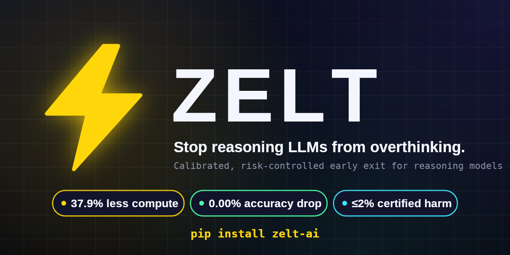
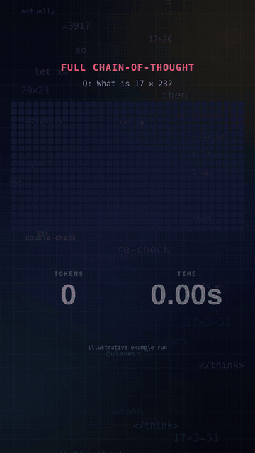
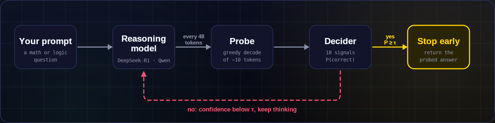

<div align="center">

# Zelt: Stop Reasoning LLMs From Overthinking

### Calibrated, risk-controlled early exit for reasoning models.

**Get the same answer in fewer tokens. Stop thinking the moment the answer is ready.**

[](https://pypi.org/project/zelt-ai/)
[](https://www.python.org/downloads/)
[](#installation)
[](#rest-service)
[](https://github.com/astral-sh/ruff)
[](LICENSE)

**[PyPI](https://pypi.org/project/zelt-ai/) · [Documentation](DOCUMENTATION.md) · [Research paper](PAPER.md) · [Changelog](CHANGELOG.md)**

[Quick start](#quick-start) · [How Zelt works](#how-zelt-works) · [What you can use it with](#what-you-can-use-it-with) · [Examples](#examples) · [Results](#measured-performance) · [FAQ](#faq) · [Documentation](#documentation)

<code>pip install zelt-ai</code>

</div>

> [!IMPORTANT]
> Get Zelt from [codewithulavesh/zelt](https://github.com/codewithulavesh/zelt) or the
> [`zelt-ai` package on PyPI](https://pypi.org/project/zelt-ai/). The package name is
> **`zelt-ai`**; you import it as `zelt`. A similar repository or package name does not
> establish that a download is official.

<div align="center">

<br />



<br /><br />



<br />

<sub>Illustrative example run: the answer was ready at token 144, but full chain-of-thought kept going to 576.</sub>

<br />

</div>

---

Reasoning models such as DeepSeek-R1 and Qwen2.5-Math think out loud before they answer. That thinking makes them accurate, but they often keep going long after the answer is settled, re-checking and second-guessing for hundreds of tokens you pay for in time and compute.

Zelt watches the reasoning as it unfolds. At regular intervals it takes a cheap look at what the model would answer right now, scores how trustworthy that answer is, and stops generation once it is confident enough. The confidence threshold is calibrated with a finite-sample statistical bound, so you get a measured, bounded accuracy risk instead of a guess.

Zelt runs locally on CUDA, Apple Silicon (MPS) or CPU, and can also sit in front of an existing Ollama or vLLM server. No hosted API is required.

## Quick start

### Install

With Python 3.9+ and pip installed, run:

```bash
pip install zelt-ai
```

Add extras when you need them:

| Command | Adds | Use it when |
| --- | --- | --- |
| `pip install zelt-ai` | SDK, CLI, benchmark, calibration, bundled decider (CPU) | You want to evaluate or integrate quickly |
| `pip install "zelt-ai[model]"` | Local Hugging Face inference (PyTorch) | You run models on your own GPU or Apple Silicon |
| `pip install "zelt-ai[server]"` | REST service and web studio | You deploy Zelt as a service |
| `pip install "zelt-ai[full]"` | `model` + `server` | You want everything |

### Ask a question

```python
import zelt

res = zelt.ask("What is 17 * 23?")

print(res.answer)     # "391"
print(res.tokens)     # tokens generated before Zelt stopped
print(res.summary())  # latency, savings and confidence breakdown
```

That is the whole integration. Zelt loads the bundled decider, runs the model, probes periodically, and returns as soon as the answer is certified ready.

### Use the terminal

```bash
zelt ask -q "What is 17 * 23?"
```

See the [CLI reference](#cli-reference) for streaming, batching, the web studio and the REST service.

### Update Zelt

```bash
pip install --upgrade zelt-ai
```

## How Zelt works

Zelt sits beside your model's generation loop. Every few tokens it probes for the current answer, scores it, and either stops or lets the model keep thinking.



1. **Periodic probes.** Every `k` tokens (default 48), Zelt briefly forces the model to commit to an answer using a short greedy decode (about 10 tokens). If the answer isn't trusted yet, the main generation simply continues.
2. **Feature extraction.** Each probe yields **18 signals**, including geometric-mean token probability, sequence entropy, **answer stability** across consecutive probes, and **confidence acceleration**.
3. **Calibrated decider.** A lightweight scikit-learn logistic regression turns those signals into `P(correct | features)`.
4. **Risk-controlled threshold.** The stopping threshold **τ** is chosen using a **Clopper-Pearson** upper confidence bound, so the *harm rate* stays at or below **α** (default **2%**) with confidence **1 − δ** (default **90%**).
5. **Adaptive stop.** The moment `P(correct) ≥ τ`, generation halts and the probed answer is returned.

*Harm* means Zelt stopped early **and** the early answer was wrong where full chain-of-thought would have been right. A plain confidence cutoff gives no guarantee on how often that happens; Zelt picks τ so the upper confidence bound on that rate is at most α, which makes the trade-off explicit and auditable.

## What you can use it with

Zelt requires Python 3.9+. Additional packages depend on how you run it:

| Target | What Zelt does | Requirements and guide |
| --- | --- | --- |
| Local Hugging Face models | Early-exit `ask()` and `generate()` through `ZeltStoppingCriteria` | `zelt-ai[model]`; CUDA, Apple MPS or CPU; [integrations](#integrations) |
| Ollama | `zelt.from_ollama(...)` wraps a running server | A running Ollama server; [Ollama and vLLM](#ollama-and-vllm) |
| vLLM / OpenAI-compatible | `zelt.from_vllm(...)` wraps a `/v1` endpoint | A running vLLM or compatible server; [Ollama and vLLM](#ollama-and-vllm) |
| Python functions | `@zelt.accelerate` adds early exit to an existing function | Core package; [examples](#examples) |
| Live streams | `zelt.stream(...)` yields tokens and probe confidence in real time | `zelt-ai[model]`; [examples](#examples) |
| Batches of questions | `zelt batch -i questions.txt` with token, cost and carbon telemetry | Core package; [CLI reference](#cli-reference) |
| Web studio | `zelt ui`: live token stream, threshold slider, savings meter | `zelt-ai[server]`; [local studio](#local-studio) |
| REST service | `zelt serve`: `/ask`, `/stream`, `/compare`, `/health`, `/metrics` | `zelt-ai[server]`; [REST service](#rest-service) |
| Agent frameworks | A reasoning tool for LangChain, AutoGen or CrewAI | Core package; [integrations](#integrations) |
| Your own reasoning traces | Train the decider and calibrate τ on your data | Your reasoning runs; [calibration](#calibrate-and-audit-on-your-own-data) |

Model presets: DeepSeek-R1-Distill-Qwen (1.5B, 7B), DeepSeek-R1-Distill-Llama-8B and Qwen2.5-Math-7B. List them with `zelt.list_presets()`.

## Examples

### Compare full reasoning with Zelt

Run both on the same question and see what you saved:

```python
import zelt

print(zelt.compare("What is 15 * 3?").summary())
```

```text
════════════════════════════════════════════════════════════
  Zelt Side-by-Side Comparison
────────────────────────────────────────────────────────────
  Question         : What is 15 * 3?
  Full CoT Answer  : 45 (576 tokens, 2.10s)
  Zelt Answer      : 45 (144 tokens, 0.54s)
  Agreement        : MATCH (Exact)
  Tokens Saved     : 432 (75.0%)
  Effective Speedup: 3.89x faster
════════════════════════════════════════════════════════════
```

*Sample output. Savings vary per question; easy questions save the most.*

### Watch the stop happen live

```python
import zelt

question = "Natalia sold 48 clips to friends and 24 to family. How many did she sell?"

for chunk in zelt.stream(question):
    if chunk.is_probe:
        print(f"\n[⚡ Probe at token {chunk.token_count}: confidence={chunk.score:.2f}]")
    elif chunk.stopped:
        print(f"\n✅ Ready! Answer: {chunk.answer}")
        break
    else:
        print(chunk.text, end="", flush=True)
```

```text
Okay, so Natalia sold 48 clips to friends and 24 to family. Let me add them...
[⚡ Probe at token 48: confidence=0.41]
48 + 24 = 72. So the total is 72...
[⚡ Probe at token 96: confidence=0.93]
✅ Ready! Answer: 72
```

*Illustrative output. Actual text and scores depend on the model.*

### Cap the budget

Stop at the first confident answer **or** at a hard token ceiling, whichever comes first:

```python
import zelt

res = zelt.token_budget(max_tokens=200, question="Calculate 125 * 8")
print(f"Answer: {res.answer} in {res.tokens} tokens")
```

### Accelerate an existing function

```python
import zelt

@zelt.accelerate
def solve_math(query: str) -> str:
    return "fallback"          # used only if the model path is unavailable

print(solve_math("What is 25 * 4?"))   # "100", exits early with compute saved
```

### Process a batch

```python
from zelt import batch

questions = ["What is 17 * 23?", "Solve 3x + 9 = 24.", "What is 15% of 240?"]
results = batch(questions)
print(results.summary())     # token, dollar and carbon savings across the batch
```

### Ollama and vLLM

Zelt talks to the server you already run, so no model needs to load in your Python process:

```python
import zelt

# Ollama
zt = zelt.from_ollama(model="deepseek-r1:1.5b", base_url="http://localhost:11434")
print(zt.ask("What is 84 / 7?").answer)

# vLLM or any OpenAI-compatible server
zt = zelt.from_vllm(
    model="deepseek-ai/DeepSeek-R1-Distill-Qwen-7B",
    base_url="http://localhost:8000/v1",
)
print(zt.ask("Solve 2x + 10 = 30").answer)
```

## Integrations

### Hugging Face `generate()`

Attach Zelt as a standard `StoppingCriteria`:

```python
from transformers import AutoModelForCausalLM, AutoTokenizer, StoppingCriteriaList
from zelt import StopDecider, ZeltStoppingCriteria

name = "deepseek-ai/DeepSeek-R1-Distill-Qwen-1.5B"
model = AutoModelForCausalLM.from_pretrained(name)
tokenizer = AutoTokenizer.from_pretrained(name)

criteria = ZeltStoppingCriteria(tokenizer, decider=StopDecider.load())

output = model.generate(
    input_ids,
    max_new_tokens=2048,
    stopping_criteria=StoppingCriteriaList([criteria]),
)
```

### FastAPI backend

```python
from fastapi import FastAPI
from zelt import reduce_compute_thinking

app = FastAPI()

@app.post("/solve")
async def solve(prompt: str):
    res = reduce_compute_thinking(prompt, verbose=False)
    return {
        "answer": str(res),
        "tokens_saved": res.tokens_saved,
        "saved_pct": res.saved_pct,
        "stopped_early": res.stopped,
    }
```

### Agent frameworks (LangChain · AutoGen · CrewAI)

Give your agent a reasoning tool that doesn't burn the context window:

```python
from zelt import ask

class EfficientReasoningTool:
    """Agent tool that prevents token overburn during reasoning loops."""

    name = "reasoning_solver"

    def run(self, problem: str) -> str:
        return str(ask(problem, verbose=False))
```

## Local studio

An interactive, fully local web UI to see how early exit behaves:

```bash
zelt ui --port 8000      # then open http://localhost:8000
```

- **Threshold slider:** adjust τ and watch the speed and risk trade-off change.
- **Live token stream and probe pulses:** follow the decider step by step.
- **Savings analytics:** token comparison bars, confidence gauges and a cost meter.

## REST service

Deploy Zelt as a microservice with metrics built in:

```bash
zelt serve --host 0.0.0.0 --port 8000
```

| Endpoint | Purpose |
| --- | --- |
| `POST /ask` | Synchronous early-exit query |
| `POST /stream` | Server-Sent Events live token stream |
| `POST /compare` | Full chain-of-thought vs early-exit benchmark |
| `GET /health` | Kubernetes liveness and readiness probe |
| `GET /metrics` | Prometheus metrics: tokens saved, queries served, latency |

```bash
curl -X POST http://localhost:8000/ask \
  -H "Content-Type: application/json" \
  -d '{"question": "What is 17 * 23?"}'
```

Docker:

```bash
docker run -p 8000:8000 zelt-ai:latest
```

## Measured performance

Evaluated on **real DeepSeek-R1-Distill-Qwen-1.5B trajectories** on **GSM8K**: 1,319 trajectories, scored on a **331-question held-out test split**.

| Method | Threshold | Accuracy | Avg tokens | Token reduction | Net incl. probes | Stop rate | Harm rate |
| --- | :---: | :---: | :---: | :---: | :---: | :---: | :---: |
| Full chain-of-thought (baseline) | n/a | **78.25%** | 750.7 | 0.0% | 0.0% | 0.0% | 0.00% |
| Fixed token budget | 1,632 | 76.74% (−1.51%) | 507.7 | 32.4% | 21.5% | 15.1% | 1.51% |
| Raw confidence | 0.79 | 78.25% | 430.6 | 42.6% | 33.4% | 40.2% | 0.00% |
| **Zelt (learned decider)** | **0.50** | **78.25%** | **465.9** | **37.9%** | **27.9%** | 37.8% | **0.00%** |

- **37.9% compute reduction** (**1.61× speedup**), or **27.9% net** once probe overhead is counted.
- **No accuracy drop** (78.25% retained) and **0.00% observed harm** on the test set.
- **Certified harm ≤ 2% at 90% confidence.**
- **AUROC 0.9976** and **ECE 0.014**, about 3× better calibrated than raw confidence.

A fixed token budget is the common baseline, and it cuts every question at the same point, which is why it loses accuracy. Zelt only stops when the answer is actually ready.

### What this means in cost

A back-of-the-envelope example using the **net** figure, so probe overhead is already included:

```text
750.7 tokens/query × 27.9% net reduction  ≈  209 tokens saved per query
1,000,000 queries                          ≈  209 million tokens saved
At an example price of $2 per 1M output tokens  →  ≈ $419 saved
```

*Hypothetical price for illustration. On self-hosted GPUs the saving shows up as lower latency and higher throughput instead.*

### Scope and limitations

- The bundled decider was trained on **DeepSeek-R1 trajectories from GSM8K-style math word problems**. On other domains or models, [re-calibrate](#calibrate-and-audit-on-your-own-data) with your own data before relying on the risk bound.
- Reported numbers come from a **single held-out split**. Treat them as strong evidence for this setup, not a universal guarantee.
- Savings vary by question: easy ones exit early, hard ones may run to completion, which is the intended behavior.

## Calibrate and audit on your own data

The risk bound is only as good as the data behind it. Zelt ships the tooling to re-fit and verify it:

```bash
# Train the decider and calibrate τ on your own reasoning runs
zelt fit --inp path/to/your_runs

# Evaluate compute reduction on the bundled real DeepSeek-R1 data
zelt benchmark

# Live early-exit generation on the held-out test split
zelt live-eval
```

```python
import zelt

# Formal finite-sample risk audit with Clopper-Pearson bounds
report = zelt.evaluate(limit=50)
print(report.summary())     # includes the exact harm upper confidence bound
```

| Knob | Default | Effect |
| --- | :---: | --- |
| `α` (harm bound) | 2% | Lower is safer, but Zelt stops later |
| `δ` (1 − confidence) | 10% (90% confidence) | Lower gives a stricter guarantee, but Zelt stops later |
| `k` (probe interval) | 48 tokens | Smaller reacts sooner, with more probe overhead |

## CLI reference

| Command | Description |
| --- | --- |
| `zelt ask -q "..."` | Early-exit inference on one question |
| `zelt demo -q "..."` | Side-by-side: full chain-of-thought vs Zelt |
| `zelt stream -q "..."` | Stream tokens live with probe confidence |
| `zelt batch -i list.txt` | Batch inference with cost and carbon telemetry |
| `zelt ui` | Local web studio at `http://localhost:8000` |
| `zelt serve` | Production REST API with Prometheus metrics |
| `zelt benchmark` | Evaluate on the bundled real DeepSeek-R1 data |
| `zelt fit --inp <path>` | Train the decider and calibrate τ on custom runs |
| `zelt live-eval` | Live early-exit generation on the held-out test split |
| `zelt selftest` | GPU-free pipeline check on synthetic data |

## FAQ

<details>
<summary><strong>Will Zelt change my model's answers?</strong></summary>

Only when it stops early *and* the early answer differs from the final one, which is what "harm" measures. Zelt bounds how often that happens (at most 2% at 90% confidence by default) and reports the observed rate, which was 0.00% on the GSM8K test split.

</details>

<details>
<summary><strong>Do I need a GPU or an API key?</strong></summary>

No API key, and no GPU is required. Zelt runs on CPU, Apple Silicon (MPS) or CUDA, and can also front an existing Ollama or vLLM server.

</details>

<details>
<summary><strong>Does it work with my model?</strong></summary>

Presets cover DeepSeek-R1-Distill (Qwen 1.5B and 7B, Llama 8B) and Qwen2.5-Math-7B. Other chain-of-thought models can work through the Hugging Face, Ollama or vLLM adapters; use `zelt fit` to calibrate the decider for them.

</details>

<details>
<summary><strong>What do probes cost?</strong></summary>

Each probe is a short (about 10 token) greedy decode every 48 tokens. That overhead is why the **net** reduction (27.9%) is lower than the **gross** reduction (37.9%) in the benchmark. Both are reported so you can judge honestly.

</details>

<details>
<summary><strong>Why not just cap the token budget?</strong></summary>

A fixed cap cuts easy and hard questions at the same point. In the benchmark a fixed budget lost 1.51% accuracy while saving less than Zelt. Zelt decides per question, based on evidence that the answer is ready.

</details>

<details>
<summary><strong>Does Zelt upload my prompts?</strong></summary>

No. Zelt runs locally and needs no hosted API. If you point it at an Ollama or vLLM server, your prompts go to that server and nowhere else.

</details>

<details>
<summary><strong>What should I do if I hit a bug?</strong></summary>

Update first; a recent release may already fix it:

```bash
pip install --upgrade zelt-ai
```

Retry the same task. If the problem persists, [open an issue](https://github.com/codewithulavesh/zelt/issues) with your Zelt version, model, steps to reproduce and error output.

</details>

## Documentation

- [Full documentation](DOCUMENTATION.md): complete technical reference.
- [Research paper](PAPER.md): the method and the Clopper-Pearson derivation (LaTeX source in [`paper/zelt_paper.tex`](paper/zelt_paper.tex)).
- [Changelog](CHANGELOG.md): what changed in each release.
- [PyPI package](https://pypi.org/project/zelt-ai/): releases and install files.
- [Issue tracker](https://github.com/codewithulavesh/zelt/issues): bugs and feature requests.

## Star history

<a href="https://www.star-history.com/?repos=codewithulavesh%2Fzelt&amp;type=date">
  <picture>
    <source media="(prefers-color-scheme: dark)" srcset="https://api.star-history.com/chart?repos=codewithulavesh/zelt&amp;type=date&amp;theme=dark&amp;legend=top-left" />
    <source media="(prefers-color-scheme: light)" srcset="https://api.star-history.com/chart?repos=codewithulavesh/zelt&amp;type=date" />
    
  </picture>
</a>

## Contributing

We'd love your help with Zelt! [Open an issue](https://github.com/codewithulavesh/zelt/issues) to report a bug or suggest a feature, or send a pull request to improve the code or docs.

```bash
git clone https://github.com/codewithulavesh/zelt.git
cd zelt
pip install -e ".[dev]"
zelt selftest          # quick pipeline check, no GPU needed
```

1. Fork the repo and create a feature branch.
2. Make your change and lint it with **Ruff**.
3. Open a pull request describing what changed and why.

## Citation

If Zelt is useful in your research, please cite it:

```bibtex
@article{karaguppi2026zelt,
  author  = {Karaguppi, Ulavayya K.},
  title   = {Zelt: Calibrated, Risk-Controlled Early Exit for Reasoning Language Models},
  journal = {arXiv preprint},
  year    = {2026},
  url     = {https://github.com/codewithulavesh/zelt}
}
```

## License

[MIT](LICENSE)

<div align="center">

**Built by [Ulavayya K. Karaguppi](https://github.com/codewithulavesh)** · Instagram [@ulavesh_7](https://instagram.com/ulavesh_7)

If Zelt saves you tokens, a ⭐ on the repo helps others find it.

</div>
