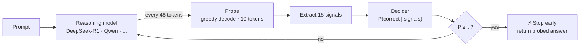

<div align="center">

# ⚡ Zelt

### Stop reasoning LLMs from overthinking.

**Calibrated, risk-controlled early exit for chain-of-thought models.**
Cut tokens and latency by stopping generation the moment the answer is ready, with a statistical bound on accuracy loss.

[](https://pypi.org/project/zelt-ai/)
[](https://www.python.org/downloads/)
[](LICENSE)
[](#-installation)
[](https://github.com/astral-sh/ruff)
[](Dockerfile)

[**Quickstart**](#-quickstart) ·
[**How it works**](#-how-it-works) ·
[**Benchmarks**](#-measured-performance) ·
[**API**](#-python-api) ·
[**CLI**](#-cli-reference) ·
[**Integrations**](#-integrations) ·
[**FAQ**](#-faq)

```bash
pip install zelt-ai
```

</div>

---

## 💡 Why Zelt?

Reasoning models such as **DeepSeek-R1** and **Qwen2.5-Math** think out loud before they answer. That thinking is what makes them accurate, but they often keep going long after the answer is already settled, re-checking and second-guessing for hundreds of tokens you pay for in time and compute.

```text
Full chain-of-thought   ████████████████████████████████████  576 tokens · 2.10 s
                        ▲ answer is already correct here
Zelt early exit         █████████                             144 tokens · 0.54 s   ⚡ stopped
```
<sub>Illustrative run on <code>What is 17 * 23?</code>. Measured averages on a real benchmark are in <a href="#-measured-performance">Measured Performance</a>.</sub>

**Zelt watches the reasoning as it unfolds.** At regular intervals it takes a cheap look at what the model would answer *right now*, scores how trustworthy that answer is, and stops generation once it is confident enough. The confidence threshold is calibrated with a finite-sample statistical bound, so you get **a measured, bounded accuracy risk instead of a guess**.

| | |
|---|---|
| 💰 **Fewer tokens** | **37.9%** fewer reasoning tokens on a real DeepSeek-R1 benchmark (27.9% net after probe overhead) |
| ⚡ **Faster answers** | **1.61×** speedup on that benchmark; individual easy questions can be much faster |
| 🛡️ **Risk-controlled** | Harm rate bounded at **≤ 2%** with 90% confidence (Clopper-Pearson). **0.00%** observed on the held-out test set |
| 🔌 **No lock-in** | Hugging Face (CUDA / Apple MPS / CPU), **Ollama**, **vLLM**, or any OpenAI-compatible server |
| 🏠 **100% local** | No OpenAI or other hosted API required |
| 🧰 **Production-ready** | Streaming, batching, REST service, Prometheus metrics, Docker, local web studio |

---

## 🚀 Installation

```bash
# Core: SDK, CLI, CPU fallback and the bundled pretrained decider
pip install zelt-ai

# + Local Hugging Face inference (PyTorch, DeepSeek-R1 on CUDA / MPS)
pip install "zelt-ai[model]"

# + REST server and web studio
pip install "zelt-ai[server]"

# Everything
pip install "zelt-ai[full]"
```

| Extra | Adds | Use it when |
|---|---|---|
| *(none)* | SDK, CLI, benchmark, calibration, bundled decider | You want to evaluate or integrate quickly |
| `model` | Local Hugging Face inference | You run models on your own GPU / Apple Silicon |
| `server` | FastAPI service and web studio | You deploy Zelt as a service |
| `full` | `model` + `server` | You want the complete toolkit |
| `dev` | Test and lint tooling | You contribute to Zelt |

> [!NOTE]
> Requires **Python 3.9+**. Runs on Apple Silicon (MPS), NVIDIA (CUDA), or plain CPU.

---

## ⚡ Quickstart

```python
import zelt

res = zelt.ask("What is 17 * 23?")

print(res.answer)     # "391"
print(res.tokens)     # tokens generated before Zelt stopped
print(res.summary())  # latency, savings and confidence breakdown
```

That is the whole integration. Zelt loads the bundled decider, runs the model, probes periodically, and returns as soon as the answer is certified ready.

Prefer the terminal?

```bash
zelt ask -q "What is 17 * 23?"
```

---

## 🧠 How it works



1. **Periodic probes.** Every `k` tokens (default 48), Zelt briefly forces the model to commit to an answer using a short greedy decode (~10 tokens). This is a cheap peek, and the main generation continues unaffected if the answer isn't trusted yet.
2. **Feature extraction.** Each probe yields **18 signals**, including geometric-mean token probability, sequence entropy, **answer stability** across consecutive probes, and **confidence acceleration**.
3. **Calibrated decider.** A lightweight scikit-learn logistic regression turns those signals into `P(correct | features)`.
4. **Risk-controlled threshold.** The stopping threshold **τ** is chosen using a **Clopper-Pearson** upper confidence bound so that the *harm rate* stays at or below **α** (default **2%**) with confidence **1 − δ** (default **90%**).
5. **Adaptive stop.** The moment `P(correct) ≥ τ`, generation halts and the probed answer is returned.

<details>
<summary><b>What is "harm" and why does the bound matter?</b></summary>

<br>

*Harm* means Zelt stopped early **and** the early answer was wrong where full chain-of-thought would have been right. That is the failure you care about.

A naive confidence cutoff gives you no guarantee on how often that happens. Zelt instead picks τ so that, on calibration data, the **upper confidence bound** of the harm rate is at most α. With the defaults, you are bounding harm at **≤ 2% with 90% confidence**, an explicit, auditable trade-off rather than a hope.

</details>

---

## 📖 Python API

### 1. One-liner inference: `zelt.ask`

```python
import zelt

res = zelt.ask("Natalia sold 48 clips in April and half as many in May. How many in total?")

print(res.answer)     # "72"
print(res.summary())
```

### 2. Live streaming: `zelt.stream`

Watch the reasoning unfold, see every probe, and catch the exact moment Zelt stops.

```python
import zelt

question = "Natalia sold 48 clips to friends and 24 to family. How many did she sell?"

for chunk in zelt.stream(question):
    if chunk.is_probe:
        print(f"\n[⚡ Probe at token {chunk.token_count}: confidence={chunk.score:.2f}]")
    elif chunk.stopped:
        print(f"\n✅ Ready! Answer: {chunk.answer}")
        break
    else:
        print(chunk.text, end="", flush=True)
```

Typical output:

```text
Okay, so Natalia sold 48 clips to friends and 24 to family. Let me add them...
[⚡ Probe at token 48: confidence=0.41]
48 + 24 = 72. So the total is 72...
[⚡ Probe at token 96: confidence=0.93]
✅ Ready! Answer: 72
```
<sub>Illustrative output. Actual text and scores depend on the model.</sub>

### 3. Side-by-side comparison: `zelt.compare`

Run full chain-of-thought and Zelt on the same question and see exactly what you saved.

```python
import zelt

print(zelt.compare("What is 15 * 3?").summary())
```

```text
════════════════════════════════════════════════════════════
  Zelt Side-by-Side Comparison
────────────────────────────────────────────────────────────
  Question         : What is 15 * 3?
  Full CoT Answer  : 45 (576 tokens, 2.10s)
  Zelt Answer      : 45 (144 tokens, 0.54s)
  Agreement        : MATCH (Exact)
  Tokens Saved     : 432 (75.0%)
  Effective Speedup: 3.89x faster
════════════════════════════════════════════════════════════
```
<sub>Sample output. Per-question savings vary; easy questions save the most.</sub>

### 4. Soft token budgets: `zelt.token_budget`

Stop at the first confident answer **or** at a hard ceiling, whichever comes first. Ideal for latency- or cost-sensitive paths.

```python
import zelt

res = zelt.token_budget(max_tokens=200, question="Calculate 125 * 8")
print(f"Answer: {res.answer} in {res.tokens} tokens")
```

### 5. Drop-in decorator: `@zelt.accelerate`

Add early exit to an existing function without restructuring your code.

```python
import zelt

@zelt.accelerate
def solve_math(query: str) -> str:
    return "fallback"          # used only if the model path is unavailable

print(solve_math("What is 25 * 4?"))   # "100", exits early with compute saved
```

### 6. Batch inference with cost tracking: `zelt.batch`

```python
from zelt import batch

questions = ["What is 17 * 23?", "Solve 3x + 9 = 24.", "What is 15% of 240?"]
results = batch(questions)
print(results.summary())     # token, dollar and carbon savings across the batch
```

From the CLI:

```bash
zelt batch -i questions.txt
```

### 7. Local models via Ollama or vLLM

No local GPU memory needed in your Python process. Zelt talks to the server you already run.

```python
import zelt

# Ollama
zt = zelt.from_ollama(model="deepseek-r1:1.5b", base_url="http://localhost:11434")
print(zt.ask("What is 84 / 7?").answer)

# vLLM or any OpenAI-compatible server
zt = zelt.from_vllm(
    model="deepseek-ai/DeepSeek-R1-Distill-Qwen-7B",
    base_url="http://localhost:8000/v1",
)
print(zt.ask("Solve 2x + 10 = 30").answer)
```

### 8. Supported model presets

```python
import zelt
print(zelt.list_presets())
```

DeepSeek-R1-Distill-Qwen (1.5B, 7B) · DeepSeek-R1-Distill-Llama-8B · Qwen2.5-Math-7B

---

## 🔌 Integrations

### Hugging Face `generate()`

Attach Zelt as a standard `StoppingCriteria`:

```python
from transformers import AutoModelForCausalLM, AutoTokenizer, StoppingCriteriaList
from zelt import StopDecider, ZeltStoppingCriteria

name = "deepseek-ai/DeepSeek-R1-Distill-Qwen-1.5B"
model = AutoModelForCausalLM.from_pretrained(name)
tokenizer = AutoTokenizer.from_pretrained(name)

criteria = ZeltStoppingCriteria(tokenizer, decider=StopDecider.load())

output = model.generate(
    input_ids,
    max_new_tokens=2048,
    stopping_criteria=StoppingCriteriaList([criteria]),
)
```

### FastAPI backend

```python
from fastapi import FastAPI
from zelt import reduce_compute_thinking

app = FastAPI()

@app.post("/solve")
async def solve(prompt: str):
    res = reduce_compute_thinking(prompt, verbose=False)
    return {
        "answer": str(res),
        "tokens_saved": res.tokens_saved,
        "saved_pct": res.saved_pct,
        "stopped_early": res.stopped,
    }
```

### Agent frameworks (LangChain · AutoGen · CrewAI)

Give your agent a reasoning tool that doesn't burn the context window:

```python
from zelt import ask

class EfficientReasoningTool:
    """Agent tool that prevents token overburn during reasoning loops."""

    name = "reasoning_solver"

    def run(self, problem: str) -> str:
        return str(ask(problem, verbose=False))
```

---

## 🖥️ Local Studio

An interactive, fully local web UI to *see* how early exit behaves.

```bash
zelt ui --port 8000      # then open http://localhost:8000
```

- 🎚️ **Threshold slider:** adjust τ and watch the speed/risk trade-off change
- 📈 **Live token stream & probe pulses:** follow the decider step by step
- 📊 **Savings analytics:** token comparison bars, confidence gauges, cost meter

---

## 🌐 REST Service

Deploy Zelt as a microservice with metrics built in.

```bash
zelt serve --host 0.0.0.0 --port 8000
```

| Endpoint | Purpose |
|---|---|
| `POST /ask` | Synchronous early-exit query |
| `POST /stream` | Server-Sent Events live token stream |
| `POST /compare` | Full CoT vs early-exit benchmark |
| `GET /health` | Kubernetes liveness / readiness probe |
| `GET /metrics` | Prometheus metrics: tokens saved, queries served, latency |

```bash
curl -X POST http://localhost:8000/ask \
  -H "Content-Type: application/json" \
  -d '{"question": "What is 17 * 23?"}'
```

**Docker**

```bash
docker run -p 8000:8000 zelt-ai:latest
```

---

## 📊 Measured Performance

Evaluated on **real DeepSeek-R1-Distill-Qwen-1.5B trajectories** on **GSM8K** (1,319 trajectories; **331-question held-out test split**).

| Method | Threshold | Accuracy | Δ Acc | Avg tokens | Token reduction | Net incl. probes | Stop rate | Harm rate |
|---|:---:|:---:|:---:|:---:|:---:|:---:|:---:|:---:|
| Full CoT (baseline) | n/a | **78.25%** | baseline | 750.7 | 0.0% | 0.0% | 0.0% | 0.00% |
| Fixed token budget | 1,632 | 76.74% | −1.51% | 507.7 | 32.4% | 21.5% | 15.1% | 1.51% |
| Raw confidence | 0.79 | 78.25% | +0.00% | 430.6 | 42.6% | 33.4% | 40.2% | 0.00% |
| **Zelt (learned decider)** | **0.50** | **78.25%** | **+0.00%** | **465.9** | **37.9%** | **27.9%** | 37.8% | **0.00%** |

**Headline results**

- ⚡ **37.9% compute reduction** (**1.61× speedup**), or **27.9% net** once probe overhead is counted
- 🎯 **No accuracy drop** (78.25% retained) with **0.00% observed harm** on the test set
- 🛡️ **Certified harm ≤ 2% at 90% confidence**
- 📐 **AUROC 0.9976** and **ECE 0.014**, about **3× better calibrated** than raw confidence

> [!TIP]
> The fixed token budget is the common baseline: it saves tokens but loses accuracy (−1.51%) because it cuts blindly. Zelt saves more *and* keeps accuracy, because it only stops when the answer is actually ready.

### What this means in cost

A back-of-the-envelope example using the **net** figure, so probe overhead is already included:

```text
750.7 tokens/query × 27.9% net reduction  ≈  209 tokens saved per query
1,000,000 queries                          ≈  209 million tokens saved
At an example price of $2 per 1M output tokens  →  ≈ $419 saved
```
<sub>Hypothetical price for illustration. On self-hosted GPUs the saving shows up as lower latency and higher throughput instead.</sub>

### Scope and limitations

- The bundled decider was trained on **DeepSeek-R1 trajectories from GSM8K-style math word problems**. On other domains or models, **re-calibrate** with your own data (see below) before relying on the risk bound.
- Reported numbers come from a **single held-out split**. Treat them as strong evidence on this setup, not a universal guarantee.
- Savings vary by question: easy questions exit early, hard ones may run to completion, which is exactly the intended behavior.

---

## 🎛️ Calibrate and audit on your own data

The risk bound is only as good as the data behind it. Zelt ships the tooling to re-fit and verify it.

```bash
# Train the decider and calibrate τ on your own reasoning runs
zelt fit --inp path/to/your_runs

# Evaluate compute reduction on the bundled real DeepSeek-R1 data
zelt benchmark

# Live early-exit generation on the held-out test split
zelt live-eval
```

```python
import zelt

# Formal finite-sample risk audit with Clopper-Pearson bounds
report = zelt.evaluate(limit=50)
print(report.summary())     # includes the exact harm upper confidence bound
```

**Tuning the trade-off**

| Knob | Default | Effect |
|---|:---:|---|
| `α` (harm bound) | 2% | Lower = safer, stops later |
| `δ` (1 − confidence) | 10% (90% confidence) | Lower = stricter guarantee, stops later |
| `k` (probe interval) | 48 tokens | Smaller = reacts sooner, more probe overhead |

---

## 🛠️ CLI Reference

| Command | Description |
|---|---|
| `zelt ask -q "..."` | Early-exit inference on one question |
| `zelt demo -q "..."` | Side-by-side: full CoT vs Zelt |
| `zelt stream -q "..."` | Stream tokens live with probe confidence |
| `zelt batch -i list.txt` | Batch inference with cost and carbon telemetry |
| `zelt ui` | Local web studio at `http://localhost:8000` |
| `zelt serve` | Production REST API with Prometheus metrics |
| `zelt benchmark` | Evaluate on the bundled real DeepSeek-R1 data |
| `zelt fit --inp <path>` | Train the decider and calibrate τ on custom runs |
| `zelt live-eval` | Live early-exit generation on the held-out test split |
| `zelt selftest` | GPU-free pipeline check on synthetic data |

---

## ❓ FAQ

<details>
<summary><b>Will Zelt change my model's answers?</b></summary>

<br>

Only when it stops early *and* the early answer differs from the final one, which is what "harm" measures. Zelt bounds how often that happens (≤ 2% at 90% confidence by default) and reports the observed rate, which was 0.00% on the GSM8K test split.

</details>

<details>
<summary><b>Do I need a GPU or an API key?</b></summary>

<br>

No API key, and no GPU is required. Zelt runs on CPU, Apple Silicon (MPS), or CUDA, and can also front an existing Ollama or vLLM server.

</details>

<details>
<summary><b>Does it work with my model?</b></summary>

<br>

Presets cover DeepSeek-R1-Distill (Qwen 1.5B / 7B, Llama 8B) and Qwen2.5-Math-7B. Other chain-of-thought models can work through the Hugging Face, Ollama, or vLLM adapters; use `zelt fit` to calibrate the decider for them.

</details>

<details>
<summary><b>What do probes cost?</b></summary>

<br>

Each probe is a short (~10 token) greedy decode every 48 tokens. That overhead is why the **net** reduction (27.9%) is lower than the **gross** reduction (37.9%) in the benchmark. Both are reported so you can judge honestly.

</details>

<details>
<summary><b>Why not just cap the token budget?</b></summary>

<br>

A fixed cap cuts easy and hard questions at the same point. In the benchmark, a fixed budget lost 1.51% accuracy while saving less than Zelt. Zelt decides per question, based on evidence that the answer is ready.

</details>

---

## 🗂️ Project resources

- 📘 [Full documentation](DOCUMENTATION.md)
- 📄 [Research paper](PAPER.md) (LaTeX source: [`paper/zelt_paper.tex`](paper/zelt_paper.tex))
- 📝 [Changelog](CHANGELOG.md)
- 🐛 [Report a bug](https://github.com/codewithulavesh/zelt/issues)
- 📦 [PyPI package](https://pypi.org/project/zelt-ai/)

---

## 🤝 Contributing

Contributions are welcome.

```bash
git clone https://github.com/codewithulavesh/zelt.git
cd zelt
pip install -e ".[dev]"
zelt selftest          # quick pipeline check, no GPU needed
```

1. Fork the repo and create a feature branch
2. Make your change, and lint with **Ruff**
3. Open a pull request describing what changed and why

---

## 📚 Citation

If Zelt is useful in your research, please cite it:

```bibtex
@software{zelt2026,
  author  = {Karaguppi, Ulavayya K.},
  title   = {Zelt: Calibrated, Risk-Controlled Early Exit for Reasoning LLMs},
  year    = {2026},
  url     = {https://github.com/codewithulavesh/zelt}
}
```

---

## 📄 License

Released under the [MIT License](LICENSE).

<div align="center">

**Built by [Ulavayya K. Karaguppi](https://github.com/codewithulavesh)** · Instagram [@ulavesh_7](https://instagram.com/ulavesh_7)

If Zelt saves you tokens, a ⭐ on the repo helps others find it.

</div>
